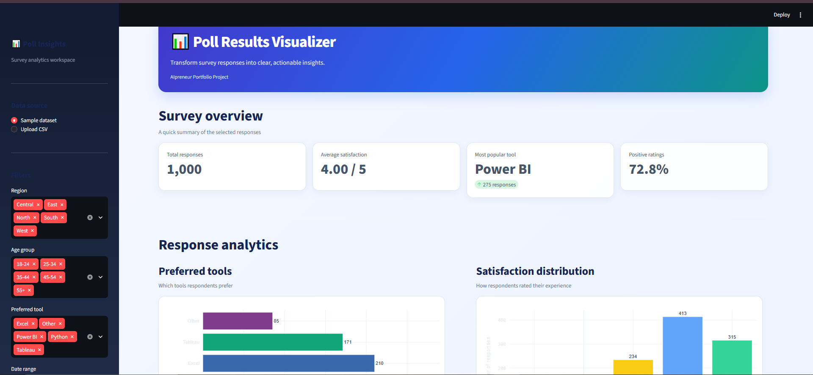

# 🗳️ Poll Results Visualizer

A professional survey analytics dashboard that turns poll responses into interactive charts and insights, built with Python and Streamlit.



## 📌 Overview
Survey data is hard to understand as raw rows. This project generates a synthetic poll dataset about **data analytics tool usage**, cleans it, analyses it and presents the results in an interactive dashboard.

## ❗ Problem
- Raw survey responses are difficult to read and compare.
- Spreadsheets do not make patterns by age group, region or time obvious.
- Open-text feedback is easy to ignore.

## ✅ Solution
An end-to-end pipeline: **generate data → load → clean → analyse → visualize**, with a Streamlit dashboard that shows the results clearly. No real personal data is used; the dataset is synthetic.

## ✨ Features
- Synthetic poll data generator (1,000 responses, 7 columns)
- Data cleaning with a quality report (duplicates, invalid ratings, missing values)
- Tool popularity and satisfaction rating analysis
- Tool preference by age group and by region
- Daily response trend
- Word cloud of open-text feedback
- Auto-generated insights
- Custom-themed Streamlit dashboard with Plotly charts

## 🧰 Tech Stack
Python · pandas · NumPy · Plotly · Matplotlib · Seaborn · WordCloud · Streamlit

## 📂 Project Structure
```
Poll-Results-Visualizer/
├── data/                  # poll_responses.csv (synthetic)
├── notebooks/             # exploration
├── src/
│   ├── data_generator.py  # creates the synthetic poll data
│   ├── data_processor.py  # loading and cleaning
│   └── analytics.py       # analysis and insights
├── outputs/               # generated reports
├── images/                # screenshots
├── app.py                 # Streamlit dashboard
├── main.py                # runs the full pipeline
└── requirements.txt
```

## ▶️ How to Run
```bash
git clone https://github.com/<your-username>/Poll-Results-Visualizer.git
cd Poll-Results-Visualizer

python -m venv .venv
.venv\Scripts\activate          # Windows
source .venv/bin/activate       # Mac / Linux

pip install -r requirements.txt
python main.py                  # run the pipeline
streamlit run app.py            # launch the dashboard
```

## 📊 Results (synthetic dataset)
- **1,000** responses analysed
- Average satisfaction rating: **4.0**
- Most popular tool: **Power BI** (275 responses, 27.5%)
- **72.8%** of respondents gave a high rating
- Data quality check: 20 missing feedback entries found and handled; no duplicates or invalid ratings


**Jatin Gujarathi** - student data analytics / AI builder
🔗 [LinkedIn](https://www.linkedin.com/in/jatin-gujarathi-bb16a7221/) · 💻 [GitHub](https://github.com/jatingujju)

